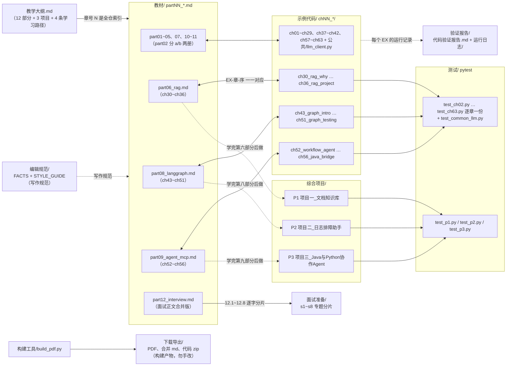

# AI 应用工程教材（面向 Java 开发者）· Python × LLM 全栈

> 一套可以实际阅读、运行代码、完成练习、开发项目、复盘面试的系统教材。
> 资料核实日期：2026-10-19。教材基于下述**实际安装并运行验证**的版本编写，不接受凭记忆的版本号。

## 仓库目录关系：先看懂，再开始



读完这张图，记住四件事：

1. **章号 N 是全仓唯一索引**：`教材/partNN_*.md`、`示例代码/chNN_*/`、`测试/test_chNN.py` 三处按同一章号对应；教学大纲每个部分标题都标注了 partNN 与章号区间（ch01 概念章无代码，ch36 的验收并入项目一）。
2. **示例编号 `EX-<章>-<序>` 三方可查**：教材正文、示例源码头注释、验证报告（运行日志按部分存档）使用同一编号，如 EX-33-02。
3. **综合项目是阶段验收**：P1/P2/P3 分别衔接第六、八、九部分，项目代码在 `综合项目/`，测试统一放在 `测试/`。
4. **`下载导出/` 是构建产物**：由 `构建工具/build_pdf.py` 从 `教材/` 与 `示例代码/` 生成；学习请读源目录，不要手改导出文件。`编辑规范/` 是作者写作规范，读者可跳过。

## 四方编号映射（以第六部分 RAG 为例）

教材 `part06_rag.md` 一册，对应 7 章、7 个示例目录、6 个章节测试 + 项目一的测试：

| 章号 | 示例代码目录 | 测试 |
|---|---|---|
| ch30 为什么 RAG | 示例代码/ch30_rag_why/ | 测试/test_ch30.py |
| ch31 文档处理 | 示例代码/ch31_doc_processing/ | 测试/test_ch31.py |
| ch32 切分 | 示例代码/ch32_chunking/ | 测试/test_ch32.py |
| ch33 检索 | 示例代码/ch33_retrieval/ | 测试/test_ch33.py |
| ch34 生成与引用 | 示例代码/ch34_generation_citation/ | 测试/test_ch34.py |
| ch35 评估 | 示例代码/ch35_evaluation/ | 测试/test_ch35.py |
| ch36 RAG 小项目（项目一雏形） | 示例代码/ch36_rag_project/ | 测试/test_p1.py（项目一测试） |

以 **EX-33-02**（ch33 的第 2 个示例）为例——全书所有 `EX-<章>-<序>` 编号都这样在三处对得上号（前言 0.6），拿到任一编号即可在教材、源码、验证报告定位同一条内容：

| 位置 | 内容 |
|---|---|
| 教材/part06_rag.md（33.4 最小完整示例） | 正文讲解与运行输出，标注 EX-33-02 |
| 示例代码/ch33_retrieval/ex_33_02_bm25.py | 可运行源码，首行注释即编号与运行命令 |
| 验证报告/运行日志/part06.md | 实际运行记录，含"发现问题→修正"的存档 |

## 如何使用本教材学习（四步）

### 第 0 步：环境准备（约 10 分钟）

```bash
git clone <本仓库地址> ai_application_course
cd ai_application_course
# Python 3.12+（本书在 3.14.7 / 3.14.8 两轮全量验证，两轮均 424 测试全绿）
python3 -m venv .venv
source .venv/bin/activate           # Windows PowerShell: .venv\Scripts\Activate.ps1
pip install -r requirements.txt     # 版本锁定；两轮验证组合见文件头注
```

验证装好了（默认 Mock 模式，不需要任何 API Key）：

```bash
python3 示例代码/ch33_retrieval/ex_33_02_bm25.py   # 跑通一个示例
python -m pytest 测试/ -q                          # 全书测试套件，预期 424 passed
```

Windows 用户注意：建议全程用 PowerShell，命令里的 `python3` 改为 `python`；PowerShell 首次激活 venv 常报"禁止运行脚本"，先执行 `Set-ExecutionPolicy -Scope CurrentUser RemoteSigned` 再激活（其余差异见 ch02 的 Windows 对照表）；测试套件在 Linux 沙箱全量验证（见 验证报告/代码验证报告.md），Windows 下个别用例可能因路径/编码等环境差异失败，不影响学习——单跑该章测试定位即可，跳过也不影响跟读。

第一个里程碑：完成第一部分 ch03 的验收——不看资料完成"干净环境建 venv → 跑程序 → 故意装错版本并修复"三连。

### 第 1 步：读导读，选一条学习路径

先读 教材/part00_preface.md（全书约定、运行模式、能力边界，约 30 分钟），再读 教学大纲.md，按自身情况选路（大纲"学习路径"原文）：

| 路径 | 走法 | 适合谁 |
|---|---|---|
| 1 从头完整 | part00 → part12 顺序学 + 项目随学随做 | 转型或系统补齐 |
| 2 Java 加速 | ch01 → ch04~ch11（速读+练习）→ ch13~ch20（精读）→ 卷二全部精读 → 项目 | 有 Spring Boot 经验 |
| 3 面试冲刺 | 每章 N.10 自测 + N.11 追问 → part12 全部 → 项目"面试讲法" | 近期求职 |
| 4 项目驱动 | 先补 ch04~ch08、ch16~ch18 与第四、六部分 → 做 P1 → 再回头补齐 | 边做边学 |

### 第 2 步：单章学习循环（核心，每章约 2~4 小时）

以 ch33（检索）为例，每章走完这五步：

```bash
# 1) 读正文：教材/part06_rag.md 第 33 章（每个示例都标注了编号与运行命令）
# 2) 跟跑该章全部示例（共 3 个；在仓库根目录执行，示例通过 示例代码.公共 包共享客户端）
python3 示例代码/ch33_retrieval/ex_33_01_numpy_vector_search.py
python3 示例代码/ch33_retrieval/ex_33_02_bm25.py
# 3) 做章内"练习"小节
# 4) 跑该章测试
python -m pytest 测试/test_ch33.py -q
# 5) 对照章末"自测检查表"（N.10）逐条自评，"面试追问"（N.11）口头答一遍
```

所有示例默认 `LLM_MODE=mock`，不需要 API Key；改真实模式见下方 FAQ。做不出测试或自测不过，回炉对应小节，不要带病前进。

### 第 3 步：阶段验收与综合项目

教学大纲每个部分末尾有"验收"条目（如第三部分："从零写出含 SSE+依赖注入+限流+pytest 的服务并全绿"），达不到就回炉。三个综合项目在对应部分学完后做，测试已备好；各项目 README 含启动命令与请求/响应示例，先照跑再改造：

| 项目 | 位置 | 学完再做 | 项目测试 |
|---|---|---|---|
| P1 企业文档知识库 | 综合项目/项目一_文档知识库 | 第六部分（RAG，ch30~36） | `python -m pytest 测试/test_p1.py -q` |
| P2 生产日志排障助手 | 综合项目/项目二_日志排障助手 | 第八部分（LangGraph） | `python -m pytest 测试/test_p2.py -q` |
| P3 Java+Python 协作 Agent | 综合项目/项目三_Java与Python协作Agent | 第九部分（Agent/MCP） | `python -m pytest 测试/test_p3.py -q` |

### 第 4 步：面试冲刺（面试准备/）

- `面试准备/` 是 教材/part12_interview.md 的**复习分片**：s1~s8 对应正文 12.1~12.8（逐字一致）；12.0（六段式与真题辨认）、12.9（Java 转 AI）、12.10（验收）只在正文里。
- 先读 面试准备/README.md 的"怎么用"四步与 30 天计划表；每题按六段式练：考查点 → 常见错误回答 → 合格回答 → 深入解释 → 工程案例 → 追问与边界。先只看题面口头答 30 秒，再对照第 3、4 段找差距。
- 全部题目均为[模拟题]（来源分级与使用纪律见正文 12.0）；冲刺期把每个项目 README 的"面试讲法"小节过一遍。

### 全程打卡

每完成一章或一个项目，把完成内容、验证结果（跑过哪些测试）、卡点、下一步记入 学习进度.md（照现有条目格式追加）；中断恢复时先读它再继续，不要凭记忆重学。

## FAQ

**Q：没有 OPENAI_API_KEY 能学吗？**
能。全书示例默认 `LLM_MODE=mock`，424 个测试全部可在无 Key 环境通过。边界要清楚：Mock 只验证程序控制流与接口契约，**不验证真实模型的回答质量与工具选择能力**（前言 0.5）。要跑真实模式：设 `LLM_MODE=real` 并配 `OPENAI_API_KEY`（兼容 OpenAI 接口的服务均可，功能支持边界见第四部分 ch24）。

**Q：Windows 能学吗？**
能，教材与代码不排斥 Windows；但全书验证环境是 Linux 沙箱，Windows 下个别测试用例可能环境性失败（路径/编码等），不影响学习。命令差异见 ch02 的 Windows 对照表与第 0 步注意事项。

**Q：pip 装不上/超时怎么办？**
换国内镜像源后重装（镜像连通性本书未验证，方法出处见 ch02）：
```bash
pip config set global.index-url https://pypi.tuna.tsinghua.edu.cn/simple
pip install -r requirements.txt
```

**Q：只想跑某一章（或某个项目）的测试？**
```bash
python -m pytest 测试/test_ch33.py -q   # 某一章
python -m pytest 测试/test_p1.py -q    # 某个项目
```

**Q：教材内容和官方文档冲突，以谁为准？**
以官方文档为准。本书全部版本事实核实于 2026-10-19，框架 API 演进很快，过期后请按 资料来源.md 的官方入口核对；各章末尾"待核实"小节列出了编写时无法完全确认的点。

## 交付物与下载

| 交付物 | 位置 |
|---|---|
| 主教材 PDF | `下载导出/ai_application_engineering.pdf` |
| 教材 Markdown 源稿 | `教材/partNN_*.md`（合并版 `下载导出/ai_application_engineering.md`） |
| 示例与项目代码 | `示例代码/`、`综合项目/`（打包 `下载导出/ai_application_code.zip`） |
| 依赖配置 | `requirements.txt`、`requirements-lock.txt` |
| 代码验证报告 | `验证报告/代码验证报告.md`、运行日志 `验证报告/运行日志/` |
| 练习与考核 | 各章"练习/自测/阶段考核"小节 |
| 面试题库 | `面试准备/`（正文 `教材/part12_interview.md`） |

## 目录（主要入口文件）

| 入口 | 说明 |
|---|---|
| 教学大纲.md | 全书目录：12 部分章号区间、4 条学习路径、每部分验收 |
| 教材/part00_preface.md | 前言与全书导读（学习第一步） |
| 教材/part01~part12 | 正文十二部分（part02 分 a/b 两册；章号区间见大纲各部分标题） |
| 示例代码/ | ch01~ch63 每章示例目录 + 公共/llm_client.py（Mock/Real 双模式共享客户端） |
| 测试/ | 逐章 pytest（test_ch02~ch63）+ test_p1/p2/p3 + test_common_llm.py |
| 综合项目/ | 三个项目，各含 README（启动命令、请求示例、排障、面试讲法） |
| 面试准备/README.md | 面试题库指南：s1~s8 分片、四步用法、30 天计划表 |
| 学习进度.md | 进度账本（打卡与跨会话恢复） |
| 验证报告/代码验证报告.md | 207 个示例 + 424 个测试的验证记录；运行日志/ 按部分存档 |
| 资料来源.md | 版本事实与官方文档入口 |
| 编辑规范/、构建工具/build_pdf.py | FACTS/STYLE_GUIDE 写作规范；从 教材/ 生成 下载导出/ 的构建脚本 |

## 诚实声明

- 本教材不承诺"读完必进大厂/必拿 Offer"；目标限定为可验证的知识、项目与面试能力。
- 所有模型示例输出均为 Mock 或示例输出，非真实模型记录；真实效果以读者实际调用为准。
- 未经生产环境验证的能力在文中明确标注（教学可运行 ≠ 生产可上线）。
- 全部面试题均为自拟模拟题，并说明真题辨认方法。
