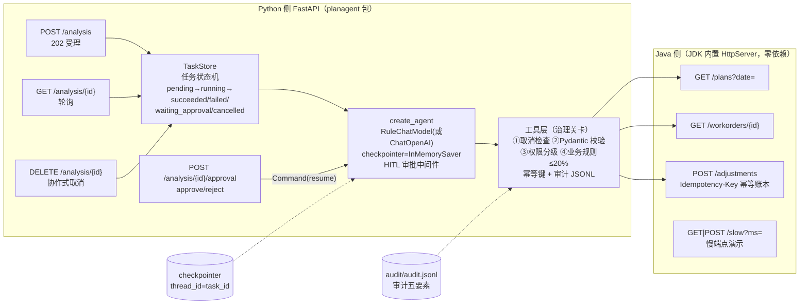

# P3 Java + Python 协作的业务 Agent（p3_java_python_agent）

> 教材项目三（第九部分 ch56 的落点）。**场景：生产计划查询与异常分析**——Java 服务模拟工厂已有的 MES/ERP 计划系统，Python 侧用 LangChain `create_agent` 构建"分析 + 建议调整"的业务 Agent，通过治理过的工具层调用 Java，对外提供**异步分析任务 API**（提交/轮询/审批/取消）。
> 沙箱全离线验证：Java 25（JDK 内置 `com.sun.net.httpserver`，零依赖）+ Python 3.14.7（`LLM_MODE=mock`，规则模型离线确定性）。环境事实见 `_meta/FACTS.md`。

## 1. 业务目标与非目标

**目标**

1. **Java 侧**（`java/PlanServer.java`，约 300 行）：生产计划查询、工单状态、提交调整（`Idempotency-Key` 幂等去重）、慢端点（超时/重试演示）四个端点；
2. **工具治理**（ch54 落地）：工具参数 Pydantic 校验、权限分级（只读/低风险写/高风险写）、幂等键生成与传递、审计 JSONL（被拒的调用也留痕）；
3. **审批链路**（ch42 + ch48 落地）：低风险调整（≤20% 幅度）Agent 直接提交；高风险调整（翻倍/急单插单）被 `HumanInTheLoopMiddleware` 拦截 → 任务转 `waiting_approval` → 人工 `approve/reject` → `Command(resume)` 恢复；
4. **异步任务模式**（ch56 落地）：`POST /analysis` 202 受理 → 后台跑 Agent → `GET /analysis/{id}` 轮询 → `DELETE` 协作式取消 → 终态 409；
5. **超时/重试语义**：JavaClient 超时三件套 + 有限重试 + 退避抖动 + 可重试白名单；对 Java `/slow` 端点有实测演示；
6. **契约对拍**：`data/*.json` 是响应形状的单一事实来源，测试逐字段核对 Java 响应与数据文件一致。

**非目标**

- 不是真实 MES/ERP：数据为内置内存种子（与 `data/*.json` 一致），重启即复位；
- 不做真实模型判断（沙箱无 Key）：`RuleChatModel` 按对话状态确定性产出动作，与真实模型契约一致（`bind_tools`/`_generate`），生产换 `ChatOpenAI` 即可（见 §3 分步 6）；
- 不做用户管理/登录：`operator`/审批人由请求体自带（教学聚焦治理链路，生产接 RBAC，ch58）；
- `TaskStore` 为进程内实现（重启丢任务）：生产替换为 DB/Redis 任务表 + 队列 worker（见 §13 扩展）。

## 2. 架构



一次高风险分析的完整时序：`POST /analysis（紧急）` → 后台线程跑 Agent：`query_plans`（读 Java）→ 模型点名 `submit_emergency_adjustment` → **HITL 拦截，invoke 返回 `__interrupt__`** → 任务转 `waiting_approval`（审批单入任务记录与审计）→ 人 `POST .../approval {"decision":"approve"}` → `Command(resume={"decisions":[{"type":"approve"}]})` → 工具体检查审批凭证（`approved_tools`）→ 幂等键提交到 Java → 任务 `succeeded`。reject 分支：中间件把工具调用替换为"User rejected"消息 → 模型给出"未执行"结论 → **Java 侧零写请求**（测试锁定）。

## 3. 目录结构与分步实现

```
projects/p3_java_python_agent/
├── java/PlanServer.java     # 步骤 1：Java 服务（4 端点 + 幂等账本 + 慢端点）
├── data/plans.json          # 步骤 2：契约数据（Java 内置种子的单一事实来源）
├── data/workorders.json
├── planagent/
│   ├── audit.py             # 步骤 3：审计 JSONL（who/when/what/outcome/trace）
│   ├── tools_layer.py       # 步骤 4：JavaClient（超时三件套+重试）+ 四道治理关卡 + @tool 工具
│   ├── agent_core.py        # 步骤 5：RuleChatModel + create_agent（checkpointer + HITL 中间件）
│   ├── task_store.py        # 步骤 7：任务状态机 + 后台执行 + 审批/取消
│   └── main.py              # 步骤 8：FastAPI 应用工厂（4 端点）
├── Dockerfile               # 步骤 9：Python 侧镜像（静态检查，Java 不进镜像）
└── README.md
```

**分步实现（每步都可独立验证）**

1. **Java 服务**：`HttpServer.create(8080)` + 线程池 executor；`/adjustments` 先查 `ADJUST_SEEN` 幂等账本（命中 → 200 重放 + `idempotent_replay=true`），未命中先入账本再返回 201（崩溃窗口的幂等保证，对应 ch48 账本层）；
2. **契约数据**：`data/*.json` 的字段集合即契约；`test_p3` 的契约测试断言 Java 响应 ⊇ 数据文件内容；
3. **审计**：`AuditLog.record()` 追加 JSONL，统一在工具执行入口调用——不散落在各工具内（ch54 纪律）；
4. **工具层**：四道关卡按序执行（取消 → 参数校验 → 权限 → 业务规则）；`submit_adjustment` 到 Java 侧取**权威现量**再核验幅度（不信模型转述）；写操作幂等键 = `sha1(plan_id|new_qty|reason|trace_id)` 截断，同一次分析内重试同 key；
5. **Agent**：`create_agent(model, tools, system_prompt, middleware=[HumanInTheLoopMiddleware(interrupt_on={"submit_emergency_adjustment": ...})], checkpointer=InMemorySaver())`——返回 LangGraph 编译图（ch42）；
6. **真实模型切换**：`LLM_MODE=real` 且设置 `OPENAI_API_KEY` 时 `build_model()` 返回 `ChatOpenAI`；提示词与工具不变。沙箱无 Key，**本书全部演示为规则模型（Mock）**；
7. **任务状态机**：`pending → running → succeeded | failed | waiting_approval | cancelled`；`waiting_approval → succeeded（审批）| cancelled（撤销）`；终态操作 409；取消置 `cancel_event`，工具入口下一检查点抛 `TaskCancelled`（协作式取消）；
8. **FastAPI**：`create_app()` 应用工厂——测试注入 `java_base_url`/审计路径，生产读环境变量；
9. **Dockerfile**：见文件头注释（仅静态检查，沙箱无 Docker）。

## 4. 契约表（Java 端点）

| 端点 | 方法 | 请求 | 成功响应 | 错误 |
|---|---|---|---|---|
| `/health` | GET | — | 200 `{"status":"UP","service":"plan-server"}` | — |
| `/plans?date=YYYY-MM-DD` | GET | query：date | 200 `{"date","count","plans":[{plan_id,product,qty,status}]}` | 400 `bad_date` |
| `/workorders/{id}` | GET | path：工单号 | 200 `{workorder_id,plan_id,status,produced_qty,target_qty}` | 404 `workorder_not_found` |
| `/adjustments` | POST | Header：**Idempotency-Key（必填）**；body `{plan_id,new_qty,reason}` | 首次 **201** `{adjustment_id,...}`；同 key 重放 **200** + `idempotent_replay:true` | 400 缺 key；422 参数/计划不存在 |
| `/slow?ms=N` | GET/POST | query：ms（≤10000） | 200 `{"ok":true,"delayed_ms":N}`（延迟 N ms 后返回） | — |

Python 侧对外端点（FastAPI，8000）：

| 端点 | 方法 | 语义 |
|---|---|---|
| `/analysis` | POST | 202 受理（异步执行），返回 `{task_id, poll}` |
| `/analysis/{task_id}` | GET | 状态与结果（404 未知任务） |
| `/analysis/{task_id}/approval` | POST | 审批 `{"decision":"approve|reject","operator":"..."}`（409 非等待态） |
| `/analysis/{task_id}` | DELETE | 取消：202 受理（协作式）/409 已终态 |
| `/health` | GET | 存活检查 |

## 5. 启动命令

```bash
# 0) 环境：Python 3.12+（本书 3.14.7 实测）、JDK 25（沙箱 Java 25.0.2 实测）、依赖 = 全书 requirements.txt
cd /workspace/ai_application_course
pip install -r requirements.txt          # 已锁定则跳过

# 1) 编译并启动 Java 服务（终端 1）
cd projects/p3_java_python_agent
javac -d java/out java/PlanServer.java
java -cp java/out PlanServer             # 打印 LISTENING port=8080；端口可用 PLAN_PORT 环境变量改

# 2) 启动 Python 服务（终端 2，仍在 projects/p3_java_python_agent 下）
python3 -m uvicorn planagent.main:app --host 127.0.0.1 --port 8000
# 环境变量：PLAN_JAVA_BASE_URL（默认 http://127.0.0.1:8080）、P3_AUDIT_PATH（默认 audit/audit.jsonl）、
#           P3_READ_TIMEOUT_S（默认 5；压 /slow 演示可调小）、LLM_MODE（mock/real）

# 3) 冒烟
curl http://127.0.0.1:8080/health && curl http://127.0.0.1:8000/health
```

## 6. 请求响应示例（真实运行记录，摘自 verification/run_logs/part09.md）

```bash
# 提交低风险分析 → 202
curl -s -X POST http://127.0.0.1:8000/analysis -H "Content-Type: application/json" \
  -d '{"question":"分析 2026-03-18 的延期计划并提交恢复调整","operator":"值班长-王"}'
# => {"task_id":"task-209dcbc4c480","status":"running","poll":"/analysis/task-209dcbc4c480"}

# 轮询（任务在数百毫秒内完成：2 次模型轮 + 2 次 Java 调用）
curl -s http://127.0.0.1:8000/analysis/task-209dcbc4c480
# => {"status":"succeeded","result":{"final":"分析结论：延期计划 P-1002 的调整已提交
#    （调整单 ADJ-0002，幂等键 adj-P-1002-1260-db10649f43）。建议跟踪工单进度确认恢复。"}}

# 高风险分析 → 暂停于审批（审批单含工具名与参数）
curl -s -X POST http://127.0.0.1:8000/analysis -H "Content-Type: application/json" \
  -d '{"question":"紧急：把延期的计划翻倍处理"}'
# GET /analysis/{id} =>
# {"status":"waiting_approval","approval_request":{"tool":"submit_emergency_adjustment",
#  "args":{"plan_id":"P-1002","new_qty":2400,"reason":"急单插单：P-1002 数量翻倍（...）"}}}

# 人工审批（approve → 执行；reject → 记录拒绝不执行）
curl -s -X POST http://127.0.0.1:8000/analysis/task-418ad199ede0/approval \
  -H "Content-Type: application/json" -d '{"decision":"approve","operator":"张工"}'
# => {"status":"succeeded","result":{"final":"...调整已提交（调整单 ADJ-0003...）","decision":"approve","operator":"张工"}}
```

## 7. 正常与失败路径

| 路径 | 触发 | 行为 | 验证 |
|---|---|---|---|
| 低风险自动提交 | 问题不含"紧急/翻倍" | query_plans → 对延期计划提量 5%（≤20%）→ 幂等提交 | smoke §3、test_agent_low_risk_full_flow |
| 高风险审批-批准 | 问题含"紧急/翻倍" + approve | interrupt → resume → `approved_tools` 凭证放行 → 提交 | smoke §4、test_agent_high_risk_approve |
| 高风险审批-拒绝 | 同上 + reject | interrupt → resume → 拒绝 ToolMessage → 结论"未执行"；**Java 零写请求** | smoke §5、test_agent_high_risk_reject |
| 审批前撤销 | waiting_approval 时 DELETE | 202 → cancelled；再审批/再取消 → 409 | smoke §6、test_task_store_cancel |
| 运行中取消 | running 时 DELETE | 202 → cancel_event 置位 → 下一工具检查点抛 TaskCancelled → cancelled（协作式，可能竞态为 succeeded——教学点） | test_tool_layer_cooperative_cancel |
| 幂等重放 | 同 Idempotency-Key 重复 POST | 200 + 同 adjustment_id + `idempotent_replay=true` | smoke §2、test_java_idempotency_replay |
| 超幅度改道 | new_qty 超现量 20% | `BusinessRuleError` → 不触达 Java 写接口（应改走审批） | test_business_rule_over_20pct |
| 权限拒绝 | viewer 提交调整 / 直调高风险工具 | ToolPermissionError + 审计 denied 留痕 | test_permission_denied |
| 上游超时 | Java /slow 超过 read 超时 | 有限重试（白名单）→ 耗尽抛 JavaServiceError → 任务 failed；最坏耗时有上界 | test_java_slow_endpoint_timeout_budget |
| 参数错误 | 模型给的参数不合法 | Pydantic 拒绝 → ToolValidationError（错误信息回传模型可自纠） | test_tool_args_validation |
| 未知任务/计划 | 404 语义 | 工单 404 → 工具返回"不存在"（数据非事故）；任务 404 → HTTP 404 | test_java_contract、smoke §6 |

## 8. 测试

```bash
cd /workspace/ai_application_course
python3 -m pytest tests/test_p3.py -q      # 18 个：单侧（respx 模拟 Java）+ 集成（真启动 Java 子进程）
```

覆盖清单：工具参数校验 / 权限拒绝（含审计 denied）/ 高风险闸门（绕过直调被拒）/ 业务规则超 20% 改道（不触达写接口）/ 幂等键稳定与 Header 传递 / Agent 低风险全流程（提交恰一次）/ 高风险 interrupt 载荷（不触达写接口）/ reject 不执行 / approve 恰一次执行 / 协作式取消 / JavaClient 重试白名单（5xx 重试、404 零重试）/ **契约测试（Java 响应对拍 data/*.json）** / Java 幂等重放 / /slow 超时预算 / TaskStore 生命周期与审批 / 取消与终态 409 / FastAPI 端到端（202→轮询→审批→409）/ FastAPI 取消与非法 decision 422。

集成 fixture 会自动 `javac`（如缺产物）并启动 Java 子进程（`PLAN_PORT=0` 随机端口），结束后回收——无需手工准备。

## 9. 性能 / 成本 / 安全讨论

- **性能**：一次分析 = 2 次模型调用 + 1~2 次 Java 调用（Mock 下 <100ms；真实模型瓶颈在 LLM 延迟）；任务在后台线程执行，HTTP 层即刻返回——用户侧延迟与任务时长解耦；Java 线程池 8 防慢端点拖垮全服务；
- **成本**：真实模式成本 = 模型 token（system+2 轮对话）≈ 一次普通对话量级；幂等键避免重试风暴造成的重复提交（重复任务的成本趋近零）；规则模型（Mock）模式零 API 成本，适合 CI/教学；
- **安全**：①默认拒绝——写操作需 operator 角色，高风险工具任何角色不可直调（凭证闸门）；②审批是流程控制不是提示词（ch28 红线）；③幂等键防重放；④审计五要素落 JSONL，被拒调用留痕；⑤上游错误信息不回传内部细节（JavaServiceError 统一文案）；⑥沙箱无密钥，`OPENAI_API_KEY` 仅环境变量注入（Dockerfile 无密钥）。

## 10. 排障

| 症状 | 原因 | 处置 |
|---|---|---|
| `Connection refused` 指向 8080 | Java 服务未启动 | 先起 Java（§5 步骤 1），看 `LISTENING port=` 输出 |
| `javac: file not found` | 工作目录不对 | 必须在 `projects/p3_java_python_agent/` 下执行 |
| uvicorn 启动报 `ModuleNotFoundError: planagent` | 不在 p3 目录运行 | `cd projects/p3_java_python_agent` 再 uvicorn（或设 PYTHONPATH） |
| 审批接口 409 | 任务不在 waiting_approval（已终态/已决定） | 先 GET 确认状态；每个任务只允许一次决定 |
| 任务卡 running | Java 假死（如 /slow 长睡） | JavaClient 读超时默认 5s，至多重试 3 次；调 `P3_READ_TIMEOUT_S` 复现实验 |
| 幂等重放没生效 | 两次请求 key 不同 | 幂等键含 trace_id——跨任务重放本就该是新键；同任务内重试才同 key |
| pytest 集成测试失败 `LISTENING` 断言 | 端口被占/防火墙 | fixture 用随机端口，检查本机 Java 进程残留 |
| 审计文件NotFound | P3_AUDIT_PATH 目录不可写 | 审计目录自动创建，检查父目录权限 |

## 11. Spring Boot 等价实现说明（未在沙箱运行，形状对照）

沙箱为保"零依赖可编译运行"采用了 JDK 内置 HttpServer。生产 Java 团队几乎必然用 Spring Boot——下表给出等价形状（**未在沙箱运行 Spring 版本**，代码为对照示意，依赖 `spring-boot-starter-web`）：

| 本项目（HttpServer） | Spring Boot 等价 |
|---|---|
| `server.createContext("/", PlanServer::route)` 手写路由 | `@RestController` + `@GetMapping("/plans")` 等，按注解自动路由 |
| `parseQuery/getRequestURI` | `@RequestParam String date` / `@PathVariable String id` |
| `readBody + parseJson`（手写极小解析） | `@RequestBody AdjustmentRequest req`（Jackson 反序列化到 DTO） |
| `ADJUST_SEEN: ConcurrentHashMap` 幂等账本 | 生产建议 DB 唯一索引 + `@Transactional`，或 Redis `SETNX`；Controller 前置 `@RequestMapping(headers = "Idempotency-Key")` |
| `send(ex, code, map)` 手写 JSON 输出 | 直接返回 DTO，`@ResponseStatus`/`ResponseEntity.status(...)` |
| `HttpServer.create(...).setExecutor(Executors.newFixedThreadPool(8))` | 内嵌 Tomcat 线程池（`server.tomcat.threads.max`） |
| `/slow` 手动 `Thread.sleep` | 同样一行 `Thread.sleep`（或 `Threadly`/Resilience4j 的 `TimeLimiter` 演示） |
| 异常 → 500 | `@ControllerAdvice` + `@ExceptionHandler` 统一错误体 |

等价 Controller 骨架（示意）：

```java
@RestController
@RequestMapping("/plans")
public class PlanController {
    private final PlanService service;                    // 种子数据/幂等账本下沉到 Service
    @GetMapping
    public PlansResponse plans(@RequestParam String date) { return service.byDate(date); }
}
// 调整端点：@PostMapping("/adjustments")，@RequestHeader("Idempotency-Key") String key，
// @RequestBody AdjustmentRequest req；Service 内先查幂等表再受理（与本项目语义一致）。
```

## 12. 面试讲法（模拟题）

- **一分钟版**：我做过一个 Java+Python 协作的业务 Agent：Java 用内置 HttpServer 模拟生产计划系统（含幂等写接口），Python 用 LangChain create_agent 做异常分析，工具层有四道关卡——参数校验、权限分级、幂等键、审计；高风险调整走 interrupt 人工审批；对外是异步任务 API（202+轮询+取消）。全部离线可复现，18 个测试全绿。
- **深挖点 1（幂等）**：为什么写操作必须带 Idempotency-Key？——重试是常态（超时/审批恢复重跑/网络抖动），没有 key 就没有安全重试；Java 侧按 key 去重返回首次结果，Python 侧同一次分析内确定性生成同 key。
- **深挖点 2（审批语义）**：interrupt 恢复后节点重跑，副作用怎么保证不重复？——副作用放恢复路径 + 审批凭证（approved_tools）+ 幂等键三层防线（对应 ch48）。
- **深挖点 3（异步任务）**：为什么 202 而不是 200？——202 表示"已受理尚未完成"，语义上诚实；轮询必须带上限，取消是协作式的（202 ≠ 立即停止）。

## 13. 扩展方向

1. **任务表外置**：TaskStore → SQLite/Redis/DB，支持多副本部署与任务恢复（Dockerfile 已按单 worker 注释说明）；
2. **真实模型**：`LLM_MODE=real` + `OPENAI_API_KEY`；为 RuleChatModel 的剧本写 golden set 回归（ch28）防换模型后行为漂移；
3. **审批对接飞书/工单系统**：审批单推审批平台，回调服务 translate 成 `Command(resume=...)`（ch48.8 的字段映射表可直接套用）；
4. **SSE 进度推送**：Agent `astream(stream_mode="updates")` → FastAPI StreamingResponse（ch17/ch42），轮询升级为推送；
5. **MCP 化 Java 服务**：把 Java 端点包一层 MCP server（stdio 或 Streamable HTTP，ch55），Agent 用 `langchain-mcp-adapters` 消费——工具不再与 Python 代码耦合；
6. **多租户**：thread_id 前缀租户 ID；工具层按租户收敛 Java 凭证（ch58）。
